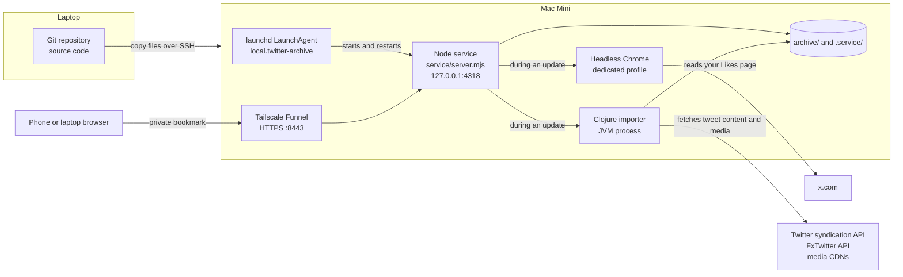
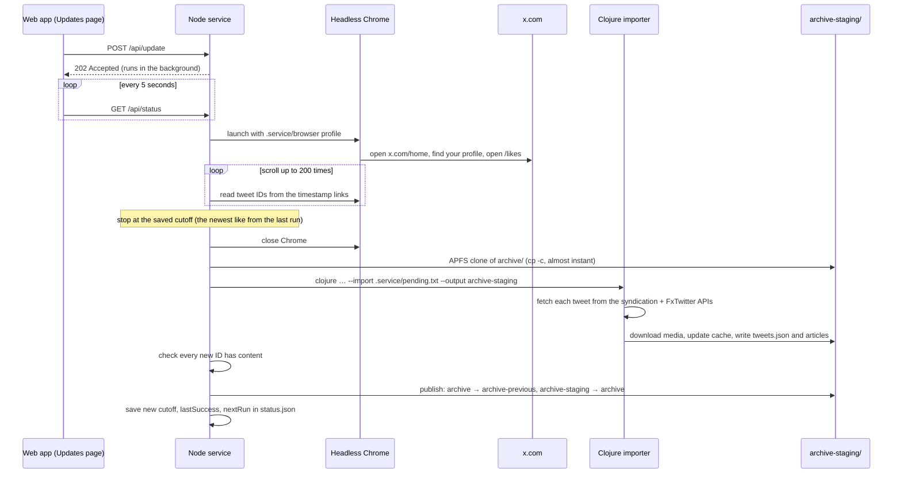
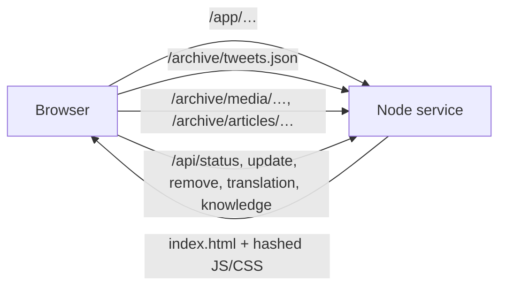

# How the archive works

This guide explains the whole system:
- where the code lives and how it reaches the Mac Mini;
- what runs on the Mini, and how;
- how an update collects new likes;
- where the data is kept;
- how the web app is served.

For everyday use see [TUTORIAL.md](TUTORIAL.md). For installation and operations see
[service/README.md](service/README.md).

## The big picture

There are two machines.

- **Your laptop** has the Git repository. This is where code is written and changed,
  including by Claude Code. Nothing on the laptop runs the archive.
- **The Mac Mini** runs everything else:
  - one long-running Node.js program, the **service**;
  - Chrome, which the service starts only while it checks your likes;
  - the Clojure importer, which the service starts only while it imports tweets.
  The Mini also holds all the data.



The Node service does four jobs in one process:
1. serves the React web app;
2. serves the archive data and media, only to signed-in browsers;
3. keeps the update schedule and runs updates;
4. runs related-tweet search and translation with small local models.

## What runs on the Mini

### Software installed beforehand

Install these with Homebrew (under `/opt/homebrew`) before installing the archive:

| Tool | Why it is needed |
| --- | --- |
| Node.js and npm | Runs the service (`service/`) and builds the web app (`web/`). |
| Java 21 (`openjdk@21`) | The Clojure importer runs on the JVM. |
| Clojure CLI (`clojure`) | Starts the importer and downloads its Java libraries. |
| Python 3 | Used only by the installer, to write the LaunchAgent and the bookmark. |
| Google Chrome (the normal app) | Signing into X, and collecting likes. |
| Tailscale | Gives the Mini a public HTTPS address (Funnel). |

Java needs one extra step. Homebrew's `openjdk@21` is "keg-only": it is not on the
`PATH`, so typing `java` in a terminal says "Unable to locate a Java Runtime". That is
expected. Everything that runs the importer sets `JAVA_HOME` to
`/opt/homebrew/opt/openjdk@21/libexec/openjdk.jdk/Contents/Home`. That includes the
installer, the LaunchAgent and manual commands.

The Clojure CLI downloads the importer's libraries the first time it runs. These are
clj-http, cheshire and tools.cli, listed in `deps.edn`, and they go to `~/.m2`. The
installer runs `clojure -P` to do that ahead of time. The importer is not compiled into a
jar. Each run starts a fresh JVM from the source files in `src/`.

Playwright is an npm package in `service/`. It normally downloads its own browser, but
this project skips that and drives the installed Google Chrome instead
(`npm ci --ignore-scripts`).

### The project folder on the Mini

The Mini has a plain copy of the project, for example `~/twitter-scraper`. It is
**not** a Git checkout. It contains:

```text
~/twitter-scraper/
├── service/  src/  web/  scripts/  deps.edn  …   code, copied from the laptop
├── service/node_modules/  web/node_modules/      installed on the Mini by npm ci
├── web/dist/                                     the built web app, built on the Mini
├── archive/            your archive (see "Where the data lives")
├── archive-previous/   the archive before the most recent change, for rollback
└── .service/           private state: credentials, X session, status, logs, caches
```

Only the code comes from the laptop. `archive/`, `.service/`, `node_modules/` and
`web/dist/` exist only on the Mini, and are never in Git.

### How it runs as a service

macOS starts the service with a **LaunchAgent**, which is a per-user background job
managed by `launchd`. The installer writes it to
`~/Library/LaunchAgents/local.twitter-archive.plist`. It says:

- run `/opt/homebrew/bin/node <project>/service/server.mjs` in the project folder;
- with `PATH`, `JAVA_HOME` and `PUBLIC_ORIGIN` set (the public HTTPS address);
- start it when the user logs in (`RunAtLoad`) and restart it if it ever exits
  (`KeepAlive`, at most every 30 seconds);
- write output to `.service/service.log` and `.service/error.log`.

It is a *user* agent, not a system daemon. That is deliberate. Chrome needs the logged-in
user's session and keychain to keep the X login. So after the Mini reboots, someone
has to log into its macOS account before the service starts.

Useful commands on the Mini:

```sh
launchctl print gui/$(id -u)/local.twitter-archive | grep -E 'state|pid'   # is it running?
launchctl kickstart -k gui/$(id -u)/local.twitter-archive                  # restart it
tail -f ~/twitter-scraper/.service/service.log                              # watch its log
```

### How it is reached from outside

The service listens only on `127.0.0.1:4318`, so other machines cannot connect to it
directly. **Tailscale Funnel** gives the Mini a public HTTPS address
(`https://MINI.TAILNET.ts.net:8443`). Funnel handles the HTTPS certificate and forwards
each request to `127.0.0.1:4318`. Your phone doesn't need Tailscale installed.

Funnel only makes the address reachable; the service decides who gets in. Your private
bookmark is the address plus `#` and a random secret token. The browser never sends the
part after `#` to any server. The unlock page (`service/dashboard.html`) reads the token
and sends it to `POST /session`. If it matches `.service/access.json`, the server sets an
HttpOnly cookie that lasts a year. Every app page, data file, media file and API checks
that cookie.

## How code gets from the laptop to the Mini

There is no automatic deployment and no Git on the Mini. Changes are copied over SSH.
When Claude Code deploys, it does this:

1. **Commit on the laptop** and run the tests there.
2. **Make sure the Mini is idle.** `.service/status.json` must show `"running": false`, so
   no update is halfway through.
3. **Copy the committed files** without touching the data:

   ```sh
   git archive HEAD README.md TUTORIAL.md deps.edn scripts service src test web \
     | ssh USER@MINI 'tar -xf - -C ~/twitter-scraper'
   ```

   `git archive` sends exactly the committed files. Files deleted in Git are *not*
   deleted on the Mini, so they have to be removed there by hand. `archive/` and
   `.service/` are never in the copy.
4. **On the Mini**, with `PATH` and `JAVA_HOME` set as above:
   - install dependencies if they changed (`npm ci --prefix service --ignore-scripts`,
     `npm ci --prefix web --ignore-scripts`, `clojure -P`);
   - run the tests (`clojure -M:test`, `npm test --prefix service`, `npm test --prefix web`);
   - rebuild the web app (`npm run build --prefix web`).
5. **Restart the service** with `launchctl kickstart -k gui/$(id -u)/local.twitter-archive`.
   Only the Node service needs a restart. The importer is a fresh JVM on every run, so it
   picks up Clojure changes automatically. The web app is read from `web/dist/`, and the
   server notices rebuilt files without a restart.
6. **Check the live site.** For example, run `node service/remote-test.mjs` on the Mini.

Instead of steps 4 and 5, you can rerun `scripts/install-mini.sh` with the same
`PUBLIC_ORIGIN`. It installs dependencies, runs every test, builds the app and
re-registers the LaunchAgent. It keeps the existing token, X session and archive.

What needs what after a change:

| Changed | Needed on the Mini |
| --- | --- |
| `web/` | `npm run build --prefix web` (no restart) |
| `service/*.mjs` | restart the service |
| `src/` (Clojure) | nothing; the next import uses it |
| `package.json` / lockfiles, `deps.edn` | `npm ci` / `clojure -P`, then restart |
| The LaunchAgent itself (in `install-mini.sh`) | rerun the installer |
| Changes to the archive format | a staged `--rebuild` of the archive (see TUTORIAL.md) |

## How an update collects new likes

### The browser is not kept open

A common guess is that a signed-in Chrome window stays open on the Mini, and the service
controls it. That's not how it works. **No browser runs between updates.** What persists
is the Chrome *profile*: a folder, `.service/browser/`, that holds Chrome's cookies.
Your X login lives there, the same way a normal Chrome stays logged in after you quit
and reopen it.

That profile is used in two ways.

- **Signing in (rare).** **Reconnect X** opens a normal, visible Chrome window on the Mini
  using that profile. Playwright is not connected, so X sees an ordinary browser. You
  sign in there. **Finish sign-in** asks that Chrome to quit normally, so it saves its
  cookies to disk, then runs an update to check that the login works.
- **Collecting likes (every update).** The service starts a new **headless** Chrome (one
  with no window) on the same profile, so it is already logged in. Playwright connects to
  it on a temporary local debugging port. When the work is done, the service closes Chrome.

### One update, step by step

An update starts either from the schedule (the service checks every 30 seconds whether
four hours have passed since the last update finished) or when you choose **Update now**.



The details:

1. **Find new likes.** The worker (`service/worker.mjs`) scrolls your Likes page and reads
   each tweet's ID from its timestamp link. It stops at the **cutoff**: the newest like it
   saw last time (`baseline` in `.service/status.json`). It compares by *position in your
   likes*, not by tweet ID or date, because you can like an old tweet today.
2. **Leave out what's already archived.** IDs already in `tweets.json`, or that you
   removed, are dropped. The rest go to `.service/pending.txt`.
3. **Fetch content without logging in.** The Clojure importer does this
   (`src/twitter_scraper/fetcher.clj`). For each ID it calls Twitter's public
   syndication API (`cdn.syndication.twimg.com`). For long tweets, articles and quotes it
   also calls the FxTwitter API. Then it downloads the photos, videos and article images.
   No API key or X login is involved. Chrome is used only to read the list of IDs.
4. **Work on a copy.** All writes go to `archive-staging/`, which is an APFS copy-on-write
   clone of `archive/`. Making it is nearly instant and uses almost no extra disk space,
   because unchanged media files share storage. The live archive isn't touched while the
   import runs.
5. **Check, then switch.** If any new like came back empty, the update fails and the
   live archive and cutoff stay as they were. The next run tries again. Otherwise two
   folder renames publish it: `archive` becomes `archive-previous`, and
   `archive-staging` becomes `archive`. If the Mini loses power between the two renames,
   the service fixes it at the next start.
6. **Record the result.** The new cutoff, time and message are saved in
   `.service/status.json`. That's what the Updates page shows.

Only one update, removal or sign-in runs at a time. If X logs you out, the update fails
with "Reconnect X". Automatic checks then wait until you sign in again.

The app loads `tweets.json` once, when it opens. After an update, reload the app to see
the new likes. The browser then downloads the file again only if it has changed.

### Removing a tweet

**Remove** sends `POST /api/remove`, and the tweet disappears from the app at once:
1. The ID is added to `.service/removed.json`.
2. The server stops serving that tweet and its files immediately.
3. In the background, the worker runs the importer's `--remove` on a staged copy. That
   deletes the tweet from the cache, deletes media no other tweet uses, and records the
   ID in `archive/.removed-ids`.
4. It publishes the staged copy the same way as an update. If that fails, it retries
   every five minutes.

Both lists keep the tweet from ever being imported again.

## Where the data lives

Everything is plain files on the Mini's disk. There is no database and no cloud storage.
There are three kinds of data, and they are kept for different reasons.

### 1. The archive: `archive/` (your data — back this up)

| File | What it is | Can it be recreated? |
| --- | --- | --- |
| `.tweet-cache.edn` (about 13 MB) | **The archive itself.** One entry per tweet: text, author, date, media list with local file names, quote, article, and the raw API response. EDN is Clojure's data format, similar to JSON. | Only by fetching every tweet again, and deleted tweets can't be fetched. |
| `media/` (about 14 GB) | Downloaded photos, videos and GIFs, named `TWEETID_N.ext`. | Only while the originals are still online. |
| `articles/ID-*.jpg` | Images from X articles. | Same as media. |
| `.removed-ids` | Tweets you removed; imports skip them. | No. |
| `tweets.json` | What the app loads: every tweet, newest first, without the raw API data. | **Yes**, with `--rebuild`. |
| `articles/ID.json` | One article in the app's format: title, cover, and blocks of text. | **Yes**, with `--rebuild`. |

The cache is the source of truth. `tweets.json` and `articles/*.json` are generated
from it by `src/twitter_scraper/output.clj` at the end of every import. `--rebuild`
regenerates them without going online.

`archive-previous/` is the archive before the most recent change. It is a rollback
copy, not a backup: the next update replaces it, and it lives on the same disk.
Because it is a clone, it doesn't take another 14 GB.

### 2. Service state: `.service/` (private — never share)

| File | What it is |
| --- | --- |
| `access.json`, `private-link.txt` | The secret token and your full private bookmark. |
| `browser/` | The dedicated Chrome profile, which holds the X login. |
| `status.json` | The like-order cutoff, the last and next update times, pause and sign-in flags, and the last message. |
| `removed.json` | Removed tweet IDs. |
| `pending.txt`, `removed.txt` | Lists of IDs passed to the importer. |
| `service.log`, `error.log` | Output from the service. |

These are excluded from Git and must not be published. Losing `status.json` only loses
the cutoff, so the next update looks for overlap with the archive again. Losing
`access.json` means making a new bookmark. Losing `browser/` means signing into X again.

### 3. Caches the service can rebuild: also in `.service/`

| File | What it is |
| --- | --- |
| `models/` | Downloaded model weights: MiniLM for related tweets, NLLB for translation. |
| `knowledge.json` | Vectors that describe each tweet's meaning, used by **Related** and search. Rebuilt from `tweets.json`; the service checks for changes every minute. |
| `translations/` | Saved English translations, keyed by the original text. |

You can delete these. The service rebuilds them, slowly.

### In the browser

The browser holds a copy of `tweets.json` in memory while the app is open, and keeps
the downloaded file in its HTTP cache. It also remembers the light or dark theme. It
never stores anything else, and nothing is sent anywhere except the Mini.

## The web app

The app is in `web/`: React and plain JavaScript, built with Vite into static files in
`web/dist/`. It is a single-page app. The same Node service that runs updates also
serves it. There is no separate web server.



- **The pages.** Any `/app/…` address returns the same `index.html`. The app's small
  router (`web/src/router.js`) shows the right page: Likes, a tweet, an article,
  Random or Updates.
- **The data.** On start the app downloads `/archive/tweets.json`. Keyword search,
  filtering, sorting and shuffling then happen in the browser (`web/src/search.js`,
  `web/src/tweets.js`), so they're instant. Search also asks the Mini for likes with a
  similar meaning (`web/src/useSearch.js`) and merges them in when they arrive.
  - The server sends that file gzip-compressed (about 0.9 MB instead of 2.6 MB), with an
    ETag. On the next visit the browser asks whether it changed, and gets "304 Not
    Modified" with no download when it hasn't.
  - The server leaves out removed tweets, and prepares the file again only when it or
    the removed list changes.
- **Media and articles** are loaded as needed from `/archive/media/…` and
  `/archive/articles/…`. Videos support range requests, so you can skip ahead.
- **The APIs** need the same cookie:
  - **Updates**: `/api/status`, `/api/update`, `/api/connect`, `/api/finish`.
  - **Remove**: `/api/remove`.
  - **Related and search by meaning**: `/api/knowledge/related`, `/api/knowledge/search`.
  - **Translation**: `/api/translation`.

  POST requests must also come from the archive's own address.
- **Development.** On the laptop, `node service/preview-knowledge.mjs` serves the local
  archive copy without doing any updates. `npm run dev --prefix web` then gives a
  live-reloading app that sends its data requests to it.

## The code, by folder

| Folder | Language | Role |
| --- | --- | --- |
| `service/server.mjs` | Node.js | HTTP server: sign-in, protected files, APIs, the four-hour schedule. |
| `service/worker.mjs` | Node.js | Chrome sign-in and collection, staged imports, removal, publishing. |
| `service/knowledge.mjs`, `translation.mjs` | Node.js | Local models for related tweets and translation. |
| `service/dashboard.html` | HTML | The unlock page that turns the bookmark into a cookie. |
| `src/twitter_scraper/` | Clojure | The importer: parse exports, fetch content, download media, keep the cache, write the app data. |
| `web/src/` | React | The web app. |
| `scripts/install-mini.sh` | Bash | Installs dependencies, runs tests, builds the app, registers the LaunchAgent and makes the bookmark. |
| `test/`, `service/*test.mjs`, `web/src/*.test.js` | | Tests (see README.md, "Validation"). |

The importer also works on its own from a terminal. It handles a Twitter data export,
specific IDs, retweets, removal, repairs and `--rebuild`. See TUTORIAL.md. The service
uses only `--import` and `--remove`.
